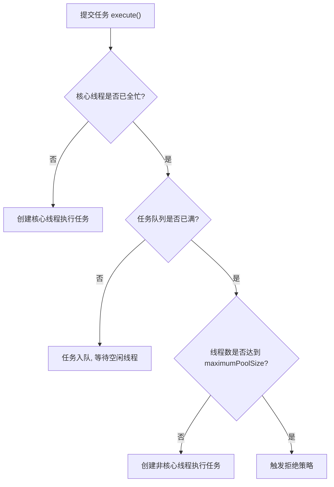

# Java 线程池详解

## 一、什么是线程池？

线程池（ThreadPool）就是一个**管理和复用一组线程的容器**：任务来了从池里取一个空闲线程执行，执行完归还给池子，而不是"来一个任务 `new` 一个线程，用完就销毁"。

**生活类比 —— 餐厅的厨师团队：**

| 餐厅场景 | 线程池概念 |
|---|---|
| 养着 2 名正式厨师，没订单也不辞退 | 核心线程（corePoolSize） |
| 高峰期临时再请 3 名厨师帮忙 | 非核心线程（maximumPoolSize - corePoolSize） |
| 迎宾区最多挂 3 张待做订单 | 任务队列（workQueue） |
| 临时厨师闲超过 30 秒就辞退 | 空闲存活时间（keepAliveTime） |
| 正式厨师全忙、订单也挂满才请临时厨师 | 扩容规则 |
| 实在忙不过来就拒收新订单 | 拒绝策略（RejectedExecutionHandler） |

## 二、为什么要用线程池？

1. **降低开销**：线程创建和销毁很"贵"，复用线程减少系统资源消耗
2. **提高响应速度**：任务到达时直接执行，无需等待创建线程
3. **控制并发数量**：防止线程无限膨胀，耗尽 CPU / 内存
4. **统一管理**：便于线程命名、统计、监控和优雅关闭

## 三、核心参数（ThreadPoolExecutor 七大参数）

| 参数 | 含义 | 餐厅类比 |
|---|---|---|
| `corePoolSize` | 核心线程数 | 正式厨师数量（常驻） |
| `maximumPoolSize` | 最大线程数 | 正式 + 临时厨师上限 |
| `keepAliveTime` + `unit` | 非核心线程空闲存活时间 | 临时厨师闲多久被辞退 |
| `workQueue` | 任务队列 | 挂单区（最多挂几张待做订单） |
| `threadFactory` | 线程工厂 | 给厨师发工牌（线程命名） |
| `handler` | 拒绝策略 | 忙不过来时如何打发新订单 |

## 四、任务提交后的处理流程（考点！）




⚠️ 注意顺序是：**核心线程 → 任务队列 → 临时线程 → 拒绝**，而不是"核心满了直接扩容"。队列没满就不会创建非核心线程，这是面试常考细节。

## 五、可运行代码

```java
package _01thread;

import java.util.concurrent.*;
import java.util.concurrent.atomic.AtomicInteger;

/**
 * 线程池生活案例：餐厅的厨师团队
 *
 * 餐厅规则：
 *   1. 2 名正式厨师（核心线程）：无论忙不忙都保留
 *   2. 高峰期最多再雇 3 名临时厨师，共 5 名（maximumPoolSize）
 *   3. 迎宾区最多挂 3 张待做订单（有界任务队列）
 *   4. 正式厨师全忙、订单也挂满，才雇临时厨师
 *   5. 临时厨师空闲 30 秒就被辞退（keepAliveTime）
 *   6. 全部厨师都在做菜且订单也挂满时，新订单直接拒收（拒绝策略）
 */
public class ThreadPoolDemo {

    public static void main(String[] args) throws InterruptedException {

        // 创建"餐厅"：核心 2 人，上限 5 人，临时工空闲 30 秒辞退，订单队列最多挂 3 单
        ThreadPoolExecutor restaurant = new ThreadPoolExecutor(
                2,                                  // 核心厨师数
                5,                                  // 最大厨师数
                30, TimeUnit.SECONDS,               // 临时厨师空闲存活时间
                new ArrayBlockingQueue<>(3),        // 订单队列（有界队列）
                new ChefThreadFactory(),            // 给厨师线程起名字，方便观察
                new ThreadPoolExecutor.AbortPolicy() // 拒绝策略：拒单
        );

        // 10 位顾客依次下单
        for (int i = 1; i <= 10; i++) {
            int order = i;
            try {
                restaurant.execute(() -> cook(order));
            } catch (RejectedExecutionException e) {
                System.out.println("【拒单】订单-" + order + " 被拒！餐厅实在忙不过来了");
            }
        }

        // 不再接新订单，等所有订单做完
        restaurant.shutdown();
        if (restaurant.awaitTermination(1, TimeUnit.MINUTES)) {
            System.out.println("所有订单已完成，餐厅打烊～");
        }
    }

    // 做一道菜：耗时 2 秒
    private static void cook(int order) {
        String chef = Thread.currentThread().getName();
        System.out.println("【接单】" + chef + " 开始制作订单-" + order);
        try {
            TimeUnit.SECONDS.sleep(2);
        } catch (InterruptedException e) {
            Thread.currentThread().interrupt();
        }
        System.out.println("【出餐】" + chef + " 完成订单-" + order);
    }
}

// 自定义线程工厂：让每个厨师线程都有名字
class ChefThreadFactory implements ThreadFactory {
    private final AtomicInteger seq = new AtomicInteger(1);

    @Override
    public Thread newThread(Runnable r) {
        return new Thread(r, "厨师-" + seq.getAndIncrement());
    }
}
```


**预期运行结果**（线程调度顺序不固定，以下为示意）：

```
【接单】厨师-1 开始制作订单-1
【接单】厨师-2 开始制作订单-2
【接单】厨师-3 开始制作订单-6     ← 队列满后才出现的临时厨师
【接单】厨师-4 开始制作订单-7
【接单】厨师-5 开始制作订单-8
【拒单】订单-9 被拒！餐厅实在忙不过来了
【拒单】订单-10 被拒！餐厅实在忙不过来了
【出餐】厨师-1 完成订单-1
【出餐】厨师-2 完成订单-2
【接单】厨师-1 开始制作订单-3     ← 做完菜的厨师接着取排队订单
【接单】厨师-2 开始制作订单-4
【出餐】厨师-3 完成订单-6
【接单】厨师-3 开始制作订单-5
...
所有订单已完成，餐厅打烊～
```


**观察要点（结合流程理解）：**

- 订单 1、2 触发创建核心厨师（厨师-1、2 号）
- 订单 3、4、5 进入队列排队（控制台暂时看不到它们，入队不打印）
- 队列满了，订单 6、7、8 才创建临时厨师（厨师-3、4、5 号）
- 队列满且已到最大线程数，订单 9、10 被拒
- 8 个订单共 16 秒工作量，5 名厨师并行 ≈ **4 秒做完**，体现线程池价值

## 六、拓展知识

**1. 四种拒绝策略：**

| 策略 | 行为 | 餐厅类比 |
|---|---|---|
| `AbortPolicy`（默认） | 抛 `RejectedExecutionException` | 明确告诉顾客"接待不了" |
| `CallerRunsPolicy` | 提交任务的线程自己执行 | 老板亲自下厨 |
| `DiscardPolicy` | 悄悄丢弃任务 | 订单直接扔了，不吭声 |
| `DiscardOldestPolicy` | 丢弃队列中最老的任务再重试 | 退掉最早的单，接新单 |

**2. 为什么推荐手动 `new ThreadPoolExecutor`，而不是 `Executors` 快捷方法？**

- `Executors.newFixedThreadPool()` / `newSingleThreadExecutor()`：队列是无界的 `LinkedBlockingQueue`，任务堆积可能导致 **OOM**
- `Executors.newCachedThreadPool()`：最大线程数是 `Integer.MAX_VALUE`，可能创建海量线程导致崩溃

阿里《Java 开发手册》明确要求：**线程池必须手动创建**，明确各参数含义。

**3. `shutdown()` 与 `shutdownNow()`：**

- `shutdown()`：不再接新任务，**已提交的任务（含队列中）会做完**——优雅打烊
- `shutdownNow()`：尝试中断正在执行的任务，队列中未执行的任务被返回——紧急关门

## 小结

线程池的本质就是**用固定成本（核心线程）+ 弹性扩容（临时线程）+ 排队缓冲（队列）+ 兜底方案（拒绝策略）** 来应对波动的任务量，正如餐厅用固定厨师团队应对客流高峰。掌握 `ThreadPoolExecutor` 七大参数和"核心 → 队列 → 扩容 → 拒绝"的执行流程，就能在实际开发中根据业务场景（CPU 密集型建议 `N+1`，IO 密集型建议 `2N` 左右）合理配置线程池。